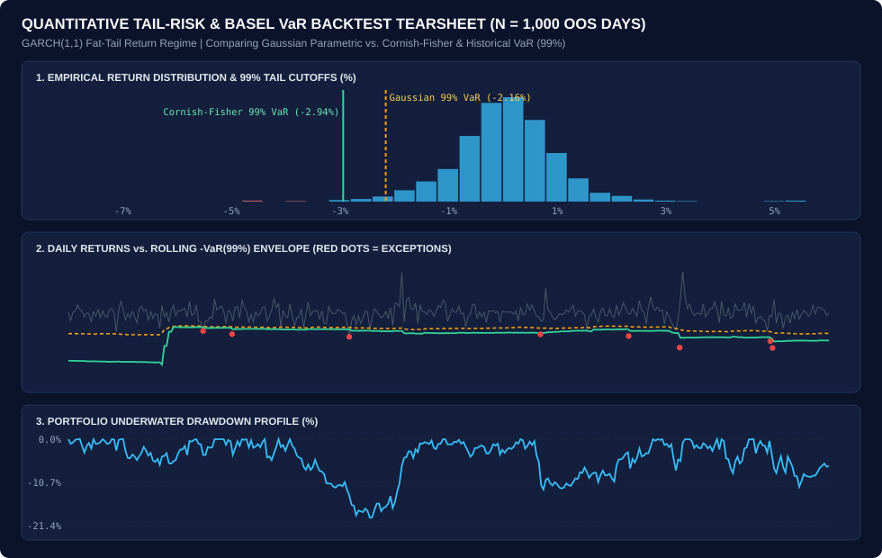

# Quantitative Market Risk, Tail-Risk VaR/CVaR & Basel Backtesting Engine

**Abu Ishak** · B.Sc. (Honours) in Statistics, Jagannath University  
[](https://www.linkedin.com/in/abuishak/)
[](mailto:a6uishak@gmail.com)

---

## Executive Summary & Academic Foundation

This repository operationalizes the statistical risk frameworks from my B.Sc. (Honours) Statistics Thesis at Jagannath University: **"Zeroing In on Risk: A Quantitative Analysis of Challenges and Solutions in Algorithmic Market Trading."**

Standard Gaussian Value-at-Risk models systematically underestimate tail losses during volatility clustering and skewed drawdowns. This engine implements **Parametric (Normal), Historical Simulation, Cornish-Fisher (Skew/Kurtosis-Adjusted), and Monte Carlo Student-t VaR & Expected Shortfall (CVaR)** alongside **Basel III Market Risk Validation** (`Kupiec POF`, `Christoffersen Independence`, and `250-Day Traffic-Light Zones`).

---

## Mathematical Formulations

- **Parametric Gaussian VaR & CVaR:** $\text{VaR}_\alpha = -(\mu + z_\alpha \sigma)$, $\text{CVaR}_\alpha = -\mu + \sigma \frac{\phi(z_\alpha)}{\alpha}$
- **Cornish-Fisher Adjusted Quantile (incorporating Skewness $S$ and Excess Kurtosis $K$):**

$$z_{\text{CF}} = z_\alpha + \frac{(z_\alpha^2 - 1)S}{6} + \frac{(z_\alpha^3 - 3z_\alpha)K}{24} - \frac{(2z_\alpha^3 - 5z_\alpha)S^2}{36}$$

- **Kupiec (1995) Proportion of Failures (POF) Likelihood Ratio:**

$$\text{LR}_{\text{POF}} = -2 \ln\left[\frac{(1 - \alpha)^{N - x}\,\alpha^x}{(1 - \hat{p})^{N - x}\,\hat{p}^x}\right] \sim \chi^2_1$$

---

## Empirical Validation Results ($N = 1{,}000$ Out-of-Sample Days)

Tested on a GARCH(1,1) volatility-clustered, negatively skewed Student-t return series (`Daily Vol: 0.95%`, `Skew: 0.06`, `Excess Kurtosis: 3.71`, `Max Drawdown: -19.43%`, `Max Underwater Duration: 190 days`, `Ulcer Index: 6.70`):

- **Full-Sample `99%` Risk Estimates:** Gaussian VaR `2.16%` vs. Historical CVaR `3.24%`, Monte Carlo Student-t VaR `2.49%`, and Monte Carlo Student-t CVaR `3.41%`.

### Rolling 250-Day `99%` VaR Basel Backtest (Expected Exceptions = `10.0 / 1,000` Days)

| VaR Model | Breaches (`N=1,000`) | Breach Rate | Kupiec $\text{LR}_{\text{POF}}$ (`p-val`) | `Pass (95% Conf.)` | Christoffersen $\text{LR}_{\text{IND}}$ `p-val` | Last 250D Basel Zone |
| :--- | :---: | :---: | :---: | :---: | :---: | :--- |
| **Gaussian Parametric VaR** | `22 / 1000` | `2.20%` | `10.84` (`p = 0.001`) | **False (Rejected)** | `0.505` | `YELLOW (8 breaches)` |
| **Historical Simulation VaR** | `13 / 1000` | `1.30%` | `0.83` (`p = 0.362`) | **True (Pass)** | `0.157` | `YELLOW (5 breaches)` |
| **Cornish-Fisher VaR** | **`8 / 1000`** | **`0.80%`** | **`0.43` (`p = 0.510`)** | **True (Pass)** | **`0.719`** | **`GREEN (3 breaches)`** |

**Key Institutional Takeaway:** Under heavy tails (`Excess Kurtosis = 3.71`), standard Gaussian VaR suffers more than **2x the expected tail breaches (`2.20%` vs `1.00%`)** and is statistically rejected by the Kupiec POF test (`p = 0.001`). Accounting for higher moments via Cornish-Fisher VaR restores regulatory calibration (`p = 0.510`) and keeps the desk in the **Basel Green Zone (`3` breaches in the trailing 250 days)**.



---

## Repository Structure & Quickstart

```text
quantitative-var-drawdown-engine/
├── README.md
├── requirements.txt
├── run_tearsheet.py              # Full GARCH/Student-t simulation, Basel backtest & SVG tearsheet
├── src/
│   ├── risk_metrics.py           # Parametric, Historical, Cornish-Fisher, Monte Carlo VaR/CVaR & Drawdown
│   └── basel_backtesting.py      # Kupiec POF, Christoffersen Independence & Basel Traffic-Light Zones
└── assets/
    └── var_tail_risk_tearsheet.svg
```

```bash
pip install -r requirements.txt
python run_tearsheet.py
```

---

## Limitations & Future Extensions
- **Extreme Skew / Higher-Order Breakdown:** Cornish-Fisher expansions can become non-monotonic under extreme kurtosis; pairing them with Extreme Value Theory (Peaks-Over-Threshold Generalized Pareto tails) is a natural next step for Tier-1 market risk desks.

> *Disclaimer: Analytical risk-modeling demonstration prepared for banking, market risk, and quantitative research roles.*
